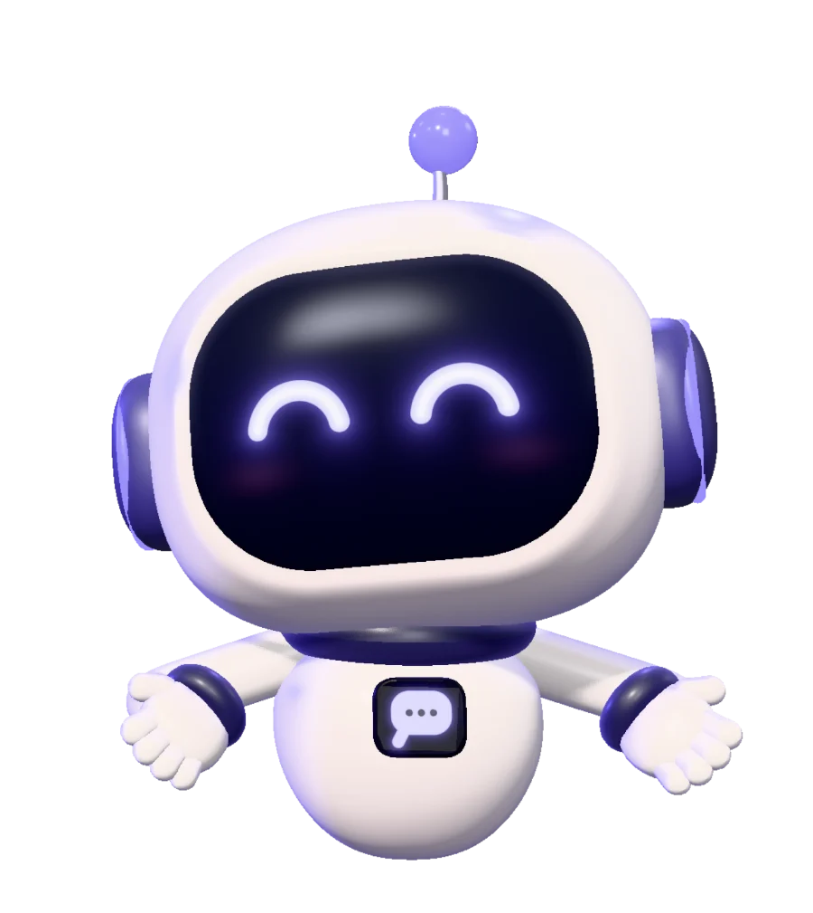
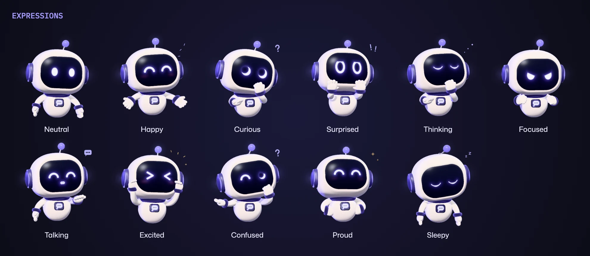
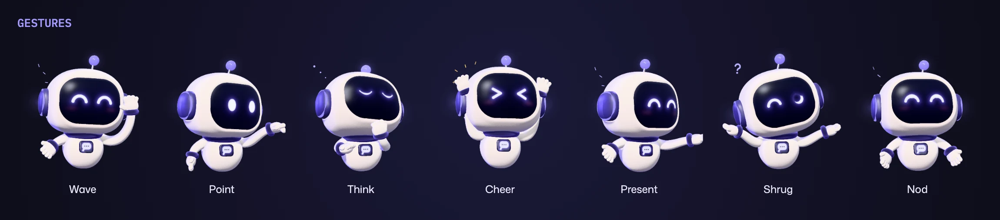
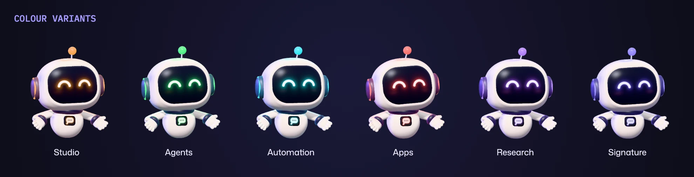
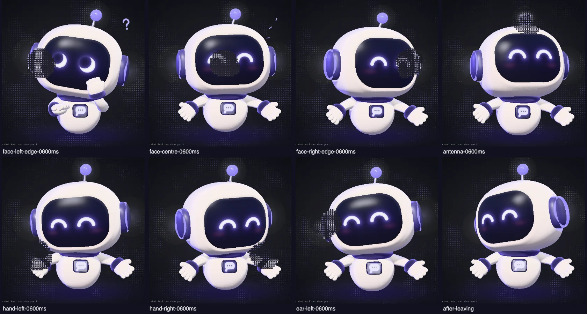
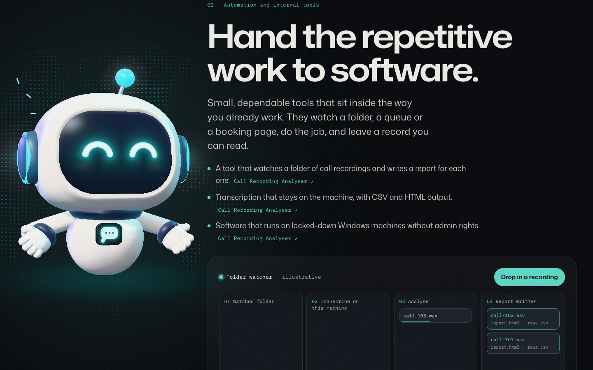
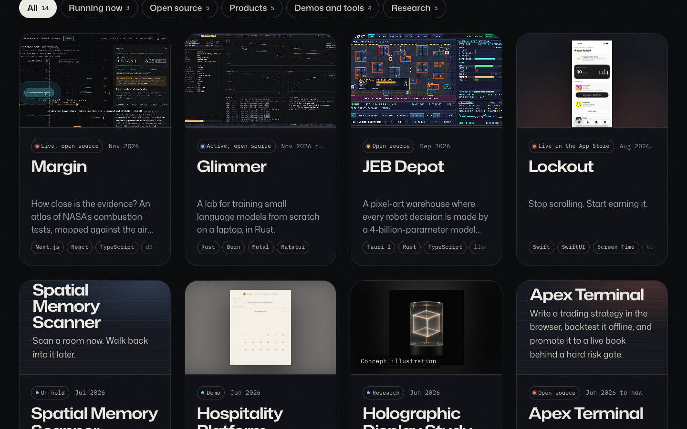
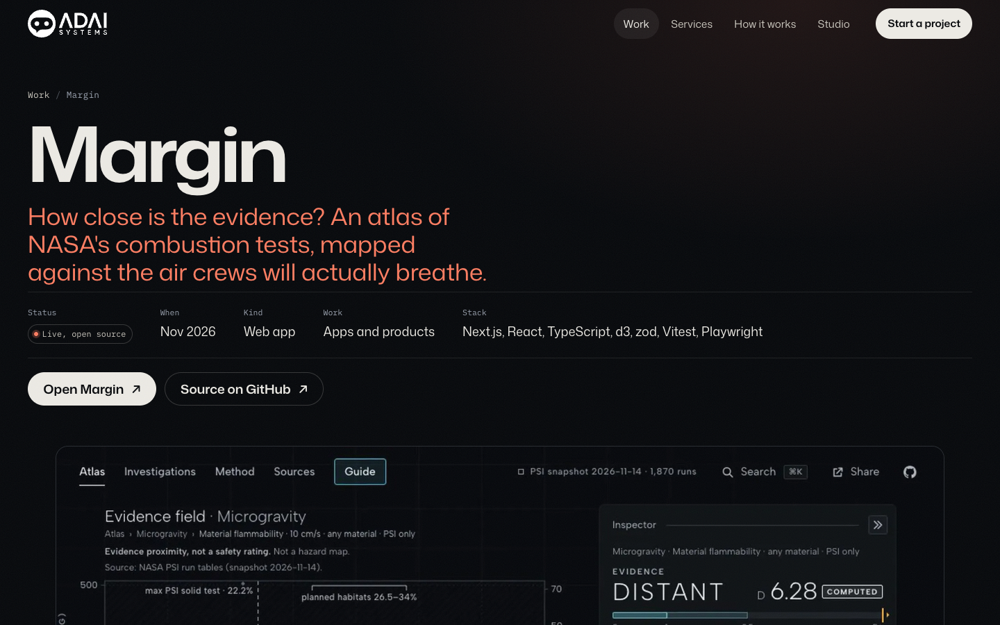
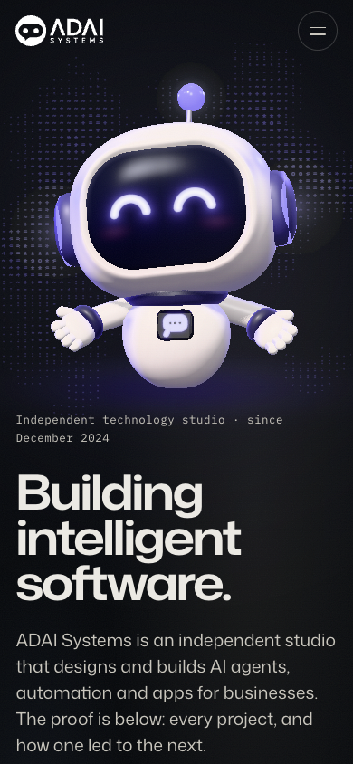
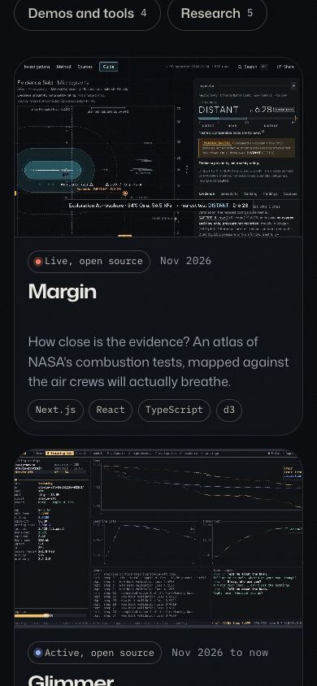

<p align="center"></p>

<p align="center">
  <a href="https://adai.systems"></a>
  
  
  
  
  
  
  <a href="https://adai.systems"></a>
  
</p>

**ADAI Systems** is an independent technology studio, run by Alex, that designs and builds AI agents, automation, apps and research prototypes. This repository is its website: every project the studio has made, four services backed by that proof, and a short path to starting a project.

The site is built around **Auri**, an original real-time 3D character: a floating companion with a smooth ivory shell, a big black face display, expressive luminous eyes, a glowing antenna and the ADAI speech bubble on its chest. Auri follows your cursor, reacts to what you do and changes colour with the kind of work on screen. Under your cursor it turns into typographic glyphs.

<p align="center"></p>
<p align="center"><sub>The home page at 1440 × 900. Auri is drawn live in the browser with WebGL; the headline and every link are ordinary HTML.</sub></p>

- **Live site:** https://adai.systems
- **Start a project:** https://adai.systems/start
- **Meet Auri:** https://adai.systems/mascot
- **Contact:** alex@adai.systems

## Contents

[What the site does](#what-the-site-does) · [Auri](#auri) · [Visual identity](#visual-identity) · [Tour](#a-tour-of-the-site) · [Tech stack](#tech-stack) · [Architecture](#architecture) · [Run it](#run-it) · [Quality](#quality) · [Deployment](#deployment) · [Content and privacy](#content-and-privacy) · [How AI was used](#how-ai-was-used) · [Ownership](#ownership)

## What the site does

| Job | How |
|---|---|
| **Show the work** | Fifteen projects since December 2024, each with a case study: facts, real screenshots or video, what was built, how it works and "said plainly", which states the limits. Paused and discontinued work stays listed. |
| **Explain the services** | AI agents and voice, automation and internal tools, apps and products, research and prototypes. Every capability links to the project that proves it. |
| **Show it working** | Four live demonstrations on the home page: an agent call replay, a folder-watching automation pipeline, real app screens, and real replies from a model trained from scratch. |
| **Win work** | A brief builder at `/start` writes the enquiry email as you answer. Nothing is sent from the site: it opens in your own mail app. |

## Auri

<p align="center"></p>

Auri is a floating companion. Its design follows a reference sheet supplied by Alex; everything on the site is the real-time model, built in code.
- **A face that is a display.** A large, glossy black display is set into an oversized soft head. The eyes are designed shapes (smiling arcs, crescents, rings, closed curves, chevrons), drawn as signed distance fields so they stay sharp and morph smoothly.
- **The ADAI mark, worn.** The mark is a speech bubble with eyes: Auri's face carries the eyes, and the bubble, with its three dots, glows on its chest.
- **Smooth and soft.** A smooth satin ivory shell (no grain or texture), a navy collar and cuffs, chunky mitten hands, indigo ear modules with light rings, and a glowing antenna. One lavender accent, which changes with the work.

| | |
|---|---|
| **Expressive** | 11 expressions (neutral, happy, curious, surprised, thinking, focused, talking, excited, confused, proud, sleepy). Each changes the eye design, the head, the posture, the arms and the antenna, and shows a small symbol, like the reference sheet. |
| **Gestures** | 7 gestures (wave, point, think, cheer, present, shrug, nod) made with real arm, hand and finger movement. They compose with expressions: Auri can look curious while pointing. |
| **Alive** | Gaze led by the eyes, then head, then body. It hovers, breathes, blinks, glances around now and then, reacts when you rest the cursor on it or click it, and gets sleepy if left alone. |
| **In the story** | Each section of the home page has its own pose and colour. Auri glides between them as you scroll, and nothing hijacks the scroll. |
| **Made of letters** | A small circle of typographic glyphs follows your cursor (or your finger, on a phone) over Auri. The glyphs are set in IBM Plex Mono, and the densest one is the ADAI mark. |
| **Replaceable** | The site talks to Auri through one interface. An authored Blender model (GLB) can replace the procedural one with a single manifest change. See [docs/MASCOT.md](docs/MASCOT.md). |

<p align="center"></p>
<p align="center"></p>
<p align="center"></p>
<p align="center"><sub>Every image above is rendered from the production model with <code>scripts/auri-lab.mjs</code>. The full character sheet is in <a href="docs/MASCOT.md">docs/MASCOT.md</a>.</sub></p>

<p align="center"></p>
<p align="center"><sub>The glyph lens around the character. Inside the circle every cell is glyphs (verified at 0 uncovered 3D pixels); outside it, Auri stays in 3D.</sub></p>

## Visual identity

| Swatch | Token | Hex | Meaning |
|---|---|---|---|
|  | `--ink-0` | `#06080b` | The ground |
|  | `--bone` | `#eceae4` | Text |
|  | `--amber` | `#f2b560` | AI agents and voice |
|  | `--aqua` | `#5cd6c4` | Automation and internal tools |
|  | `--coral` | `#ff7d61` | Apps and products |
|  | `--sky` | `#8db3ff` | Research and prototypes |
|  | `AURI_ACCENTS.signature` | `#8f82ff` | Auri's signature light |

- **Colour means one thing.** A hue stands for one kind of work. Auri's lights (eyes' glow, antenna, ear rings, chest emblem) take a colour for each kind of work: amber for studio, green for agents, cyan for automation, coral for apps, violet for research (`src/gl/mascot/palette.ts`).
- **Type:** Mona Sans (wide display headings) and IBM Plex Mono (facts, and Auri's glyphs), both SIL OFL and self-hosted.
- **Brand:** the genuine ADAI wordmark sits in the header and footer. The favicon is the original ADAI icon, inverted (white character, black face).

## A tour of the site

<table>
<tr>
<td width="50%"></td>
<td width="50%"></td>
</tr>
<tr>
<td><b>AI agents.</b> An illustrative call replay: ask, look up, quote, confirm, book, and recover from an interruption.</td>
<td><b>Automation.</b> The call analyser's pipeline: watched folder, on-device transcription, analysis, report.</td>
</tr>
<tr>
<td></td>
<td></td>
</tr>
<tr>
<td><b>Apps.</b> Real Lockout and Margin screens.</td>
<td><b>Research.</b> STEVIE's real, unedited replies from the Glimmer repository.</td>
</tr>
<tr>
<td></td>
<td></td>
</tr>
<tr>
<td><b>The work.</b> Every project, filterable, as uniform cards.</td>
<td><b>Case studies.</b> Facts first, then the story and its limits.</td>
</tr>
<tr>
<td></td>
<td></td>
</tr>
<tr>
<td><b>Start a project.</b> The brief writes itself. Nothing is sent from the site.</td>
<td><b>Meet Auri.</b> Try every expression, gesture and colour.</td>
</tr>
</table>

<p align="center">
  
  
  
</p>

## Tech stack

| Layer | Choice |
|---|---|
| Framework | [Astro 7](https://astro.build): static output, every page prerendered HTML |
| 3D | [three.js](https://threejs.org) r187 (WebGL2) with custom GLSL: the face shader, the glyph reduction pass and the composite |
| Character | Procedural sculpting, smooth satin materials with an accent rim glow, a signed-distance-field face with designed eye shapes, posable mitten hands (morph targets), Bézier arms and layered spring animation (`src/gl/mascot/`) |
| Scrolling | [Lenis](https://lenis.darkroom.engineering) with a fine pointer only; native scrolling otherwise |
| Language | TypeScript (strict), checked by `astro check` |
| Fonts | Mona Sans and IBM Plex Mono via Fontsource, self-hosted |
| Testing | Playwright 1.65 and axe-core 4.14 |
| Hosting | Vercel (static), `main` deploys to production |

## Architecture

```text
src/
  pages/            every route: home, work + 15 case studies, services + 4, process, studio,
                    research, start, contact, mascot, privacy, terms, 404, robots.txt, llms.txt
  components/       header, footer, cards, process steps, mascot anchors, the four demos
  content/          projects.ts, services.ts, site.ts: every fact and line of copy
  gl/               the WebGL world
    World.ts        renderer, story choreography, pointer, glyph lens, quality tiers
    mascot/         Auri: shapes, materials, face shader, expressions, emotes, palette, poses, rig + GLB adapter
    passes/         the glyph atlas and pipeline (reduction + per-cell composite)
  scripts/          site behaviour, motion preference, WebGL loader, the mascot event bus
  lib/              navigation, SEO / JSON-LD, hues, the mascot's name
public/             brand, favicons, project media (work/), share cards (og/), mascot manifest
tests/              Playwright + axe suite
scripts/            screenshots, glyph probe, load profile, icons, banner, Auri lab renders, still and GLB export
docs/               MASCOT.md, ARCHITECTURE.md, performance/ (benchmarks), screenshots and assets
```

- **One canvas, layout-driven.** Each section marks an empty box with `data-mascot-anchor` and a pose. Auri frames itself into the most central visible box, so the story is responsive by construction.
- **Glyphs that line up.** Auri renders into an HDR target. A reduction pass averages each glyph cell on exactly the pixel grid the composite draws. Inside the cursor lens each cell is either glyph or 3D, never a blend.
- **Sharp glyphs at any load.** Glyphs are drawn at the screen's own pixel density from an atlas rasterised at the exact cell size. Under load, the frame-time watchdog lowers only the 3D resolution, never the glyphs.
- **Fast first paint.** Pages ship a few kilobytes of script. The WebGL world (182 KB gzipped, Auri included: it is procedural, so there is no model to download) starts downloading at low priority as soon as the HTML is parsed, and starts once the page is idle, on real GPUs only. Nothing renders while Auri is out of view. Without WebGL, the layout closes up around the copy.
- **Pages never import WebGL.** They talk to Auri through a DOM event (`adai:mascot`).

More in [docs/ARCHITECTURE.md](docs/ARCHITECTURE.md) and [docs/MASCOT.md](docs/MASCOT.md).

## Run it

```bash
npm install
npm run dev        # http://localhost:4321
npm run build      # astro check + static build to dist/
npm run preview    # serve dist/
npm test           # Playwright + axe (builds and serves on :4322)
```

Node 22.12 or newer is required. Tests use the installed Google Chrome so WebGL runs on the GPU.

| Tool | What it does |
|---|---|
| `node scripts/glyph-probe.mjs <dir> [url] --metric [--dsf=2]` | Moves the cursor around Auri and counts any 3D pixel inside the glyph lens (expected: 0) |
| `node scripts/render-bench.mjs <url> <out.json> [--throttle] [--reading]` | Start-up (FCP, LCP, first frame, blocking time) and rendering (frame times, draw calls, rAF loops, serialised GPU cost) benchmark, cold and warm |
| `node scripts/glyph-quality.mjs <dir> <beforeUrl> <afterUrl>` | Glyph screenshots and sharpness proxies, homepage vs `/studio`, four viewports, normal and under load |
| `node scripts/serve-static.mjs <dir> [port]` | Serves a build like Vercel (clean URLs, brotli, immutable assets), for side-by-side benchmarks |
| `node scripts/touch-probe.mjs <out.png> [url]` | Drags a finger across Auri on a phone viewport and reports whether the page scrolled (expected: 0) |
| `node scripts/load-profile.mjs [url] 3 --throttle` | Times start-up (first paint, WebGL import, build, first frame) on cold and cached visits |
| `node scripts/auri-lab.mjs [url] [outDir] --sheet` | Renders every expression, gesture, colour variant and angle of the live model deterministically, and assembles the character, expression, gesture and colour sheets |
| `npm run mascot:glb` | Exports the procedural Auri as a GLB blockout for Blender |
| `npm run still` · `node scripts/build-banner.mjs` · `node scripts/build-og-mascot.mjs` · `node scripts/build-icons.mjs` | Regenerate the README art, the Meet Auri share card and the favicon set |

## Quality

- `astro check`: 0 errors, 0 warnings.
- `npm test`: 77 tests, covering:
  - every route: status, a single h1, title, description, canonical, JSON-LD and no console errors;
  - axe WCAG 2.2 AA (no serious or critical issues);
  - no horizontal scroll at 375 px;
  - the WebGL boot, and the no-WebGL fallback;
  - reduced motion;
  - the glyph lens: size, cursor following and coverage (0 uncovered pixels);
  - glyph resolution: native pixel density and a pixel-exact atlas, identical on the homepage and other pages, unchanged under sustained load (only the 3D steps down, then recovers);
  - progressive rendering: no GPU work while Auri is out of view, immediate resume, a fast scroll straight to a lower section, one WebGL context, no GPU-resource or listener leaks across scrolling and resizes, the WebGL preload hint, and reduced motion;
  - touch on a phone: a drag on Auri moves the lens without scrolling, lift and cancel release it, and swipes elsewhere scroll;
  - identical project cards at three widths;
  - no draggable images, and no highlightable display headings;
  - Auri: every expression, gesture and colour control on Meet Auri drives the character (with the matching body language, and gestures that don't override a chosen expression); emote symbols never count towards framing; resting the cursor on Auri earns one reaction, not a stream;
  - technical SEO: unique titles and descriptions, robots meta, a `WebPage` JSON-LD with the canonical URL on every page, share-image alt text, no `www` anywhere, `llms.txt` and `robots.txt`;
  - the favicon, the header wordmark, the brief builder (no network requests), filters, the 404 page and the sitemap.
- Lighthouse 13.6, mobile emulation, local build (18 November 2026):

| Page | Performance | Accessibility | Best practices | SEO |
|---|---|---|---|---|
| `/` | 89 | 100 | 100 | 100 |
| `/mascot` | 90 | 100 | 100 | 100 |
| `/work` | 96 | 100 | 100 | 100 |
| `/services/ai-agents` | 90 | 100 | 100 | 100 |
| `/studio` | 89 | 100 | 100 | 100 |

  CLS is 0.000 on every page. Some runs of `/` score about 70: Lighthouse sometimes records one multi-second task in Astro's prefetch script there. That happens on the previous build too, so it isn't caused by Auri, and it is still open.

## Deployment

The site deploys on [Vercel](https://vercel.com) from this repository:
- `main` is production; every other branch gets a preview.
- `https://adai.systems` is the canonical address; `www.adai.systems` redirects to it (308).
- `vercel.json` sets clean URLs (`/work/lockout`, matching the previous site's URLs) and cache headers for built assets.
- No environment variables are needed.

## Content and privacy

- **Facts.** Every fact comes from `src/content/` and the inventory in `docs/source/content-inventory.md`. Nothing goes on a page that is not in the inventory. Illustrative demos are labelled as such.
- **No tracking.** No analytics, cookies, third-party scripts or browser storage. Fonts and media are served from the site itself.
- **Nothing submits.** The brief builder writes an email you send yourself.
- `/privacy` and `/terms` describe the site exactly as built.

## How AI was used

The site, its character and its shaders were built with Claude Code (Anthropic) working under Alex's direction. Auri's design follows a reference sheet Alex supplied; the character on the site is procedural code, and no AI-generated images or models are used anywhere on the site. Project screenshots are real captures of the projects.

## Ownership

ADAI Systems is a technology studio operated by FitDawg Ltd.

There is no licence file in this repository. The site's code, content, design, the Auri character and its images are all rights reserved: the source is public to read, not to reuse. Projects linked from the site have their own licences in their own repositories.

Contact: alex@adai.systems
