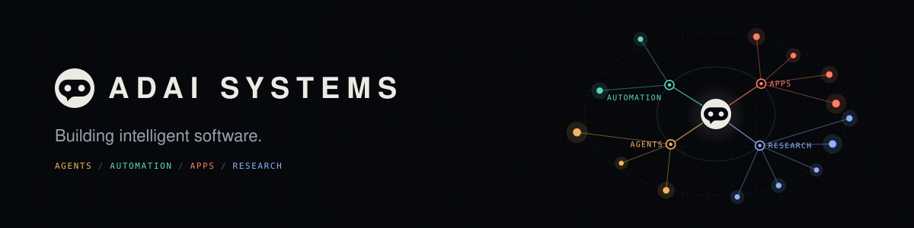
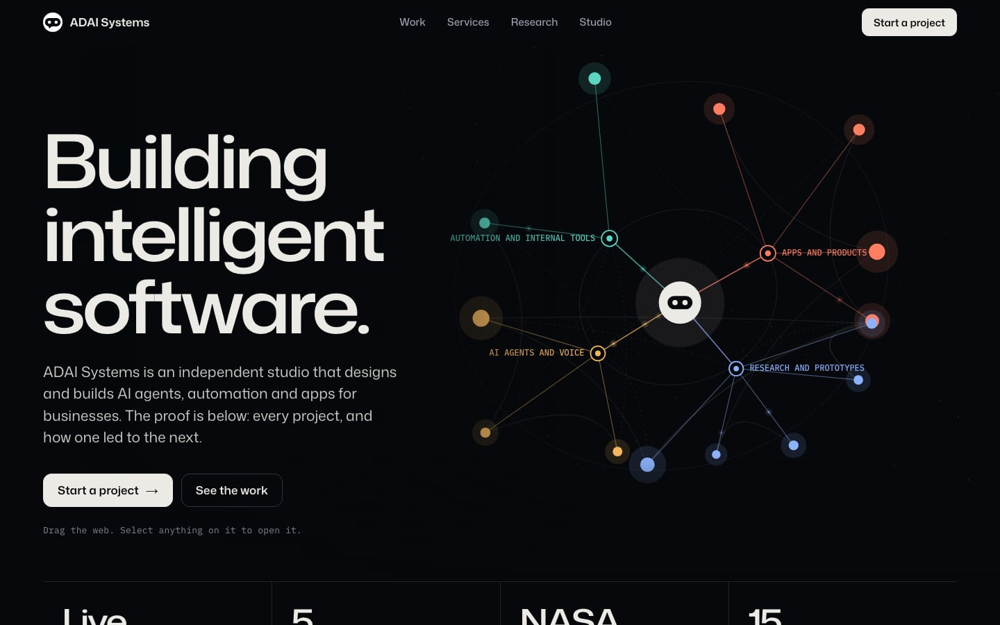
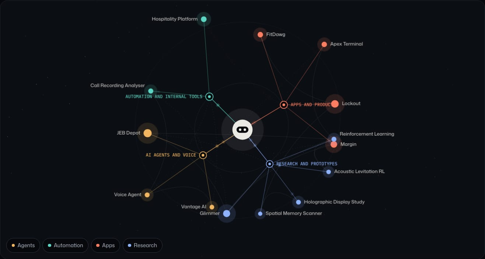
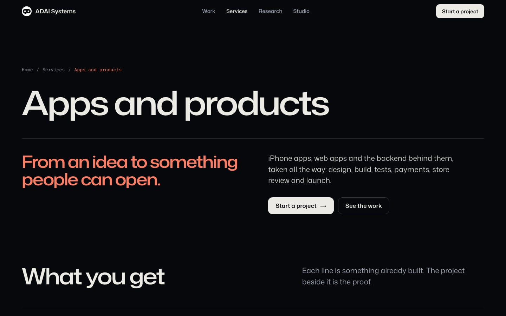
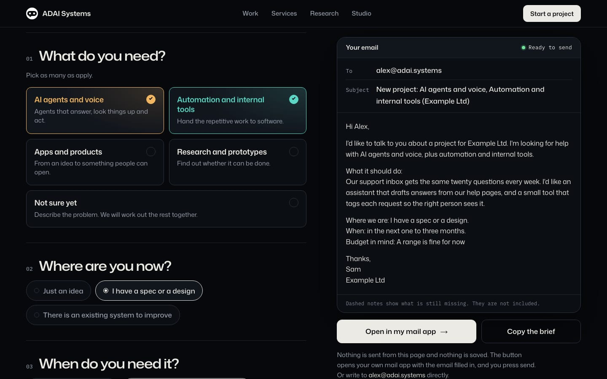
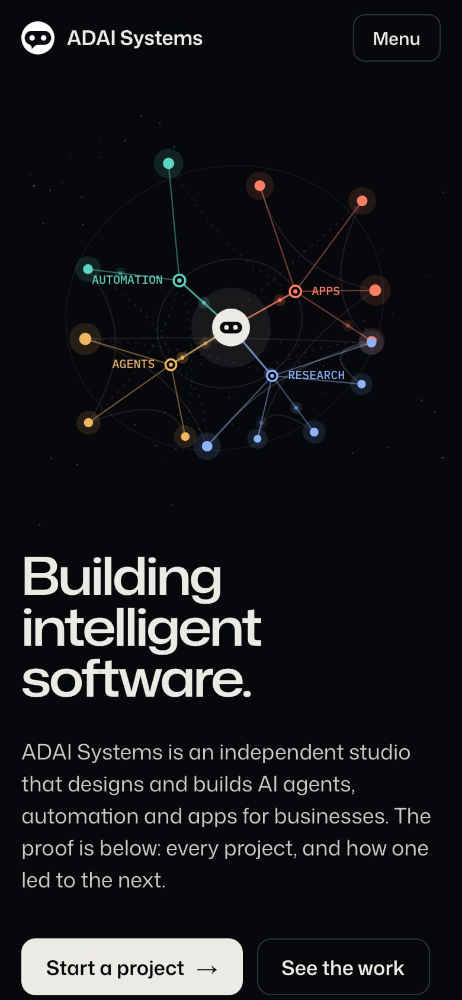
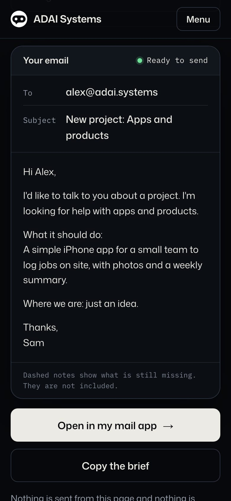
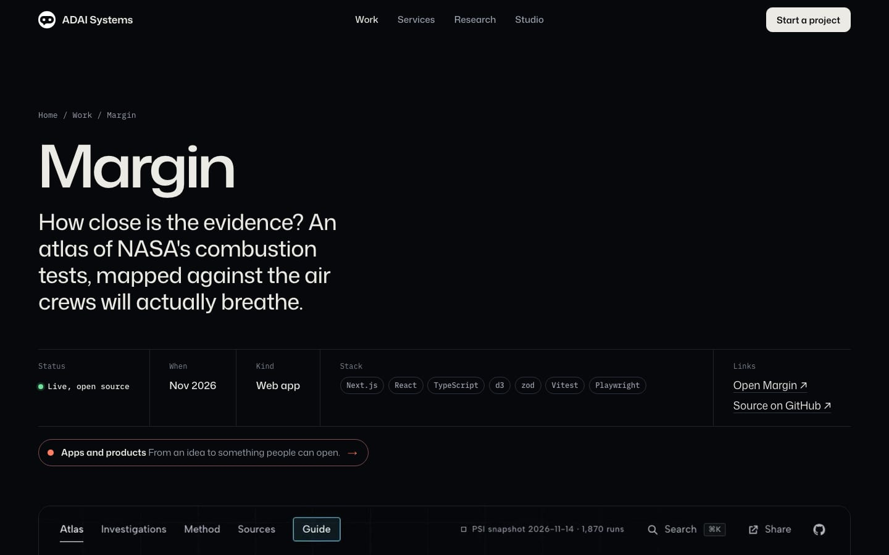
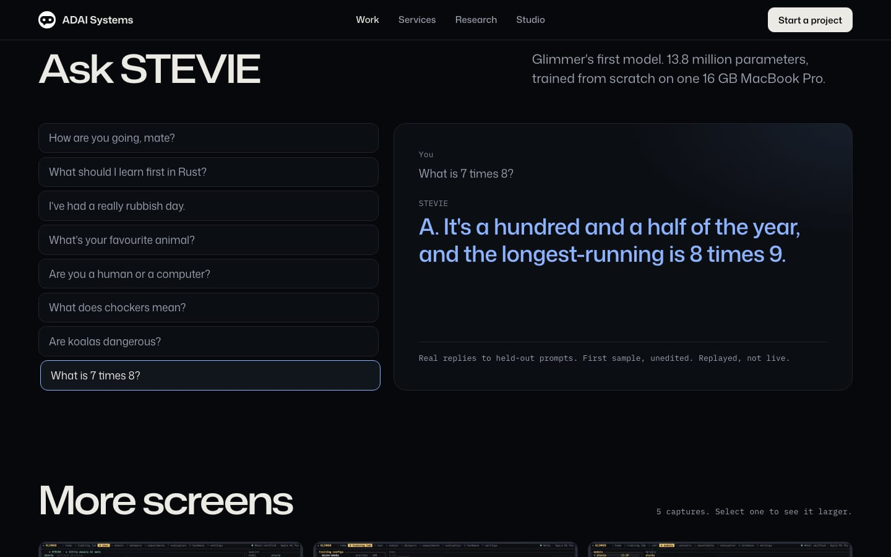
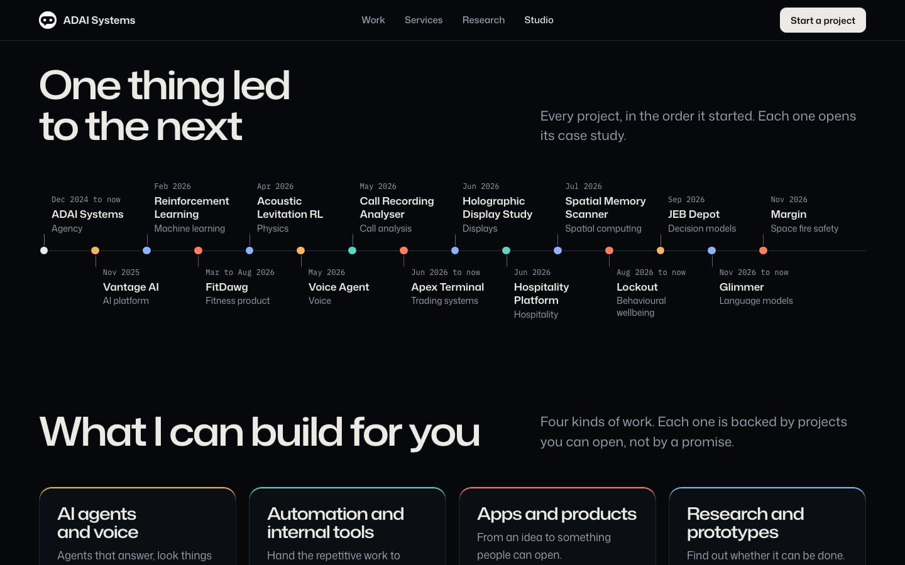

<p align="center"></p>

<p align="center">
  
  
  
  
  
  <a href="https://www.adai.systems"></a>
  
</p>

**ADAI Systems** is an independent technology studio, run by Alex, that designs and builds AI agents, automation and apps. This repository is its website: a portfolio of every project the studio has made, and a short path from that proof to starting a project.

**This is the Atlas rebuild.** It lives on the `redesign` branch in [pull request #1](https://github.com/ADAI-ALEX/adai-systems/pull/1) and is not merged yet. The live site at www.adai.systems still runs the previous version from `main`.

<p align="center"></p>
<p align="center"><sub>The home page at 1440 by 900. The web on the right is a live canvas: drag it, or select a branch or a project to open it.</sub></p>

- **Live site:** https://www.adai.systems
- **This rebuild:** [pull request #1](https://github.com/ADAI-ALEX/adai-systems/pull/1) (`redesign`)
- **Lockout** on the App Store: https://apps.apple.com/app/id6804702332
- **Margin:** https://margin.adai.systems

## Contents

[What the site does](#what-the-site-does) · [The web](#the-web) · [Pages](#pages) · [The funnel](#the-funnel) · [Case studies](#case-studies) · [The Atlas design system](#the-atlas-design-system) · [Content model](#content-model-and-adding-a-project) · [Architecture](#architecture) · [Running it](#running-it) · [Quality checks](#quality-checks) · [Privacy](#privacy) · [Deployment](#deployment) · [How AI was used](#how-ai-was-used) · [Ownership](#ownership)

## What the site does

The site has two jobs.

1. **Show the work.** Fifteen projects, from the studio's founding in December 2024 to now, each with a case study. Nothing is hidden because it was paused or dropped: discontinued and on-hold projects are listed with the rest, and labelled.
2. **Win work.** Four service pages, one for each kind of work, each backed by the projects that prove it. Every page leads to `/start`, where a visitor writes a project brief and sends it as an ordinary email.

It is built with the Next.js App Router and TypeScript, and every page is prerendered at build time. There is no CMS, no database, no analytics, no cookies and no form that submits anywhere. The fonts, Mona Sans and IBM Plex Mono, are self-hosted through `next/font`.

## The web

The signature piece of the site is **the web**: ADAI Systems at the centre, four branches (one per kind of work), and the other fourteen projects hanging from their branch. It is drawn on a canvas as a slowly turning model. You can drag it, select a node to read about it, and on `/work` highlight one branch at a time. Thin lines join projects that led to each other, and a project that also proves a second kind of work is tied to that branch too.

<p align="center"></p>
<p align="center"><sub>The full web on <code>/work</code>, with every project labelled and a legend to highlight one branch.</sub></p>

A canvas is invisible to a screen reader, so the same web is also rendered as a plain list of links underneath it, which works with a keyboard. Under `prefers-reduced-motion` the model stops turning and following the pointer, and the pulses along the branches stop. The layout comes from a seeded hash of each project's name, so it is the same on every visit. The code is in `components/site/web.tsx`.

## Pages

| Route | What it is |
|---|---|
| `/` | The headline, the web, the four services, selected work, how a project runs |
| `/work` | The full web and the archive of every project, filterable by service |
| `/work/[slug]` | Fifteen case studies |
| `/services` | The four kinds of work, side by side |
| `/services/[path]` | Four landing pages: `ai-agents`, `automation`, `apps`, `prototypes` |
| `/start` | The project brief builder |
| `/research` | The projects that exist to answer a question |
| `/studio` | Who runs the studio, the timeline of every project, and what can be hired |
| `/contact` | One address, read by a person |
| `/privacy`, `/terms` | The legal pages. Their URLs and wording are kept |
| any other path | A custom 404 that lists everything the studio has made |

## The funnel

Each service page states a promise, lists **what you get** (every line is something a named project already does, linked as proof), says when it is **a good fit**, and shows the projects behind it. Every call to action goes to `/start?type=<service>`, which opens the brief builder with that service already selected.

The brief builder asks five short questions: what you need, where you are now, when you need it, what it should do, and who you are. As you answer, it writes the email beside the form. "Open in my mail app" opens your own mail client with the email filled in, and you press send. "Copy the brief" copies it instead. The page sends nothing and stores nothing.

<table>
<tr>
<td width="50%"></td>
<td width="50%"></td>
</tr>
<tr>
<td><b>A service page.</b> <code>/services/apps</code>. The hue of the page is the hue of its branch.</td>
<td><b>The brief builder.</b> <code>/start</code>, filled in with example text. The email on the right is what gets sent, and only by you.</td>
</tr>
<tr>
<td align="center"></td>
<td align="center"></td>
</tr>
<tr>
<td><b>Home on a phone.</b> The web comes first, with shorter branch names.</td>
<td><b>The brief on a phone.</b> The preview follows the questions.</td>
</tr>
</table>

## Case studies

Every project gets a page at `/work/<slug>`, built from its entry in `content/projects.ts`. A case study opens with the facts (status, dates, kind, stack, links) and its lead media: a video, a screenshot, a row of phone captures, or a typographic plate when no images exist. Then come the rows that apply: what it is, why it exists, what was built, how it works, the numbers, where it stands, and "said plainly", which states the limits. Pages end with connected work, where there is any, and links to the older and newer projects.

<table>
<tr>
<td width="50%"></td>
<td width="50%"></td>
</tr>
<tr>
<td><b>Margin.</b> A live, open-source web app. Its page carries the site's one video, a 30-second narrated recording of the live app.</td>
<td><b>Glimmer.</b> "Ask STEVIE" replays real, unedited replies from a 13.8 million parameter model. Nothing runs live.</td>
</tr>
</table>

## The Atlas design system

The design is called **Atlas**: dark, precise and quiet, so the work and the web carry the colour. The tokens are at the top of `app/(site)/site.css`, and every page style uses only those tokens.

| Swatch | Token | Hex | Used for |
|---|---|---|---|
|  | `--ink-0` | `#06080b` | The ground |
|  | `--ink-1`, `--ink-2` | `#0b0e13`, `#11151c` | Raised surfaces |
|  | `--bone` | `#eceae4` | Text |
|  | `--mute` | `#9aa2af` | Secondary text |
|  | `--amber` | `#f2b560` | AI agents and voice |
|  | `--aqua` | `#5cd6c4` | Automation and internal tools |
|  | `--coral` | `#ff7d61` | Apps and products |
|  | `--sky` | `#8db3ff` | Research and prototypes |

**Colour means one thing.** Each hue stands for one kind of work and is never used for decoration. A container sets `data-hue="<branch>"` and everything inside it uses `var(--hue)`.

**Type.** One sans family, Mona Sans, using its width axis: headings are set wide and tight. IBM Plex Mono is used only for facts about a thing: dates, statuses, counts and stacks.

**Rules.** Real media does the visual work. Motion is quiet (hover lifts, lines that draw) and everything rests under `prefers-reduced-motion`. One `h1` per page, headings in order, alt text on every image, visible focus, controls at least 44px tall, AA contrast, and no horizontal scroll at 375px wide. No labels above headings, no gradient text and no em dashes in copy, alt text or metadata.

<p align="center"></p>
<p align="center"><sub>The timeline on <code>/studio</code>. Each dot takes the hue of its branch.</sub></p>

## Content model and adding a project

All content lives in three files:

| File | What it holds |
|---|---|
| `content/projects.ts` | Every project, the links between them, the curated lists (home showcase, research) and STEVIE's replies |
| `content/services.ts` | The four services, how a project runs, and the options in the brief builder |
| `content/site.ts` | Studio facts and shared copy |

Behind them sits `content/inventory.md`: every fact the site may state, and where it came from. **Nothing goes on a page that is not in the inventory**, so record the facts there first.

To add a project, append one object to `projects` in `content/projects.ts`:

```ts
{
  slug: "new-thing",             // becomes /work/new-thing
  title: "New Thing",
  start: "2026-12",              // sorts it on the timeline and in the archive
  dateLabel: "Dec 2026 to now",
  kind: "product",               // studio | product | research | demo | tool
  kindLabel: "Web app",
  aspect: "products",            // the branch it hangs from: agents | automation | products | research
  alsoProves: ["agents"],        // optional: other branches it also proves
  status: "active",              // active | live | open-source | demo | built | research | on-hold | discontinued
  statusLabel: "Active",
  chapter: "The new thing",      // two or three words for the timeline
  pitch: "One line.",
  summary: "A short paragraph.",
  stack: ["TypeScript"],
  links: [{ label: "Source on GitHub", href: "https://github.com/..." }],
  media: [{ src: "/work/new-thing/home.webp", alt: "...", width: 1440, height: 900, type: "screen" }], // screen | phone | pixel | concept
  video: {                       // optional
    src: "/work/new-thing/demo.mp4", poster: "/work/new-thing/demo-poster.webp",
    width: 1920, height: 1080, label: "...", seconds: 30,
  },
  story: { problem: "...", built: ["..."], how: ["..."], outcome: "...", honest: ["..."] },
}
```

Optional fields also include `points`, `facts` (key figures, each one measured and in the inventory), `disclosure` (a sentence the page must always carry) and `openSource`. Put the media in `public/work/<slug>/`.

That one object gives the project a node on the web, a card in the archive, a case study, a place on the studio timeline, a place in the counts and an entry in the sitemap. Then, if it applies:

- To join it to another project on the web and under "Connected work", add a line to `relations` in the same file.
- To show it as proof on a service page, add its slug to that service's `proof` in `content/services.ts`.
- To feature it on the home page or `/research`, add it to `showcase`, `selected` or `research`.

Finally run `npm run build && npm start`, then `npm run og` to make its share card and `npm run check` to test the site.

## Architecture

```text
app/
  (site)/            the pages; each page keeps its CSS beside it, and site.css holds the tokens
  og/[slug]/         the share card renderer, for preview builds only (404 in production)
  not-found.tsx      the custom 404
  sitemap.ts         every real page, read from the content files
components/
  site/              the page frame, the bar, shared parts, the web and the video player
  site/work/         the archive grid, the case study gallery and the STEVIE replay
  site/services/     the service visuals and the process steps
  site/start/        the brief builder
  shared/            small hooks, such as reduced motion
content/             every fact and every line of copy, and the inventory behind them
lib/                 company configuration and the preview-only guard
public/              the logo, the share cards (og/) and the project media (work/)
design/              the build brief, the taste brief, the design directions and the imagery plan
scripts/             QA, screenshots, share cards, reference capture and the local taste vault
docs/assets/         the banner and screenshots in this README
```

## Running it

Requires Node.js and npm.

```bash
npm install
npm run dev          # http://localhost:3000
npm run build        # prerender every page
npm start            # serve the build
npm run lint
npm run typecheck
npm run check        # QA against the running build (see below)
npm run og           # photograph the share cards into public/og
npm run shoot -- /work /tmp/shots/work 1440,390   # screenshot one page at given widths
npm run taste        # the taste vault, local only, at http://localhost:4319/taste
```

`npm run check` and `npm run og` expect the site on port 3000, and `npm run shoot` on port 3210. Set `BASE_URL` to point any of them elsewhere.

## Quality checks

`npm run check` (`scripts/check-site.mjs`) drives a real browser with Playwright against a running build. It reads every route from the sitemap, adds a page that does not exist, and then:

- loads each page at 375, 768, 1280 and 1920 pixels wide, and fails on horizontal overflow or a console error;
- at 1280, checks for exactly one `h1`, alt text on every image, and no em dash or `TODO` in the visible copy;
- runs axe-core on each page against WCAG 2.0 A and AA and WCAG 2.1 AA;
- follows every link on the site and fails on any error status, and checks that every email link goes to `alex@adai.systems`.

Then it drives the interactive parts:

- **the web:** the canvas has drawn, every node is also a plain link, focusing a link shows that node's card, and Enter opens the case study;
- **the work grid:** a filter narrows it;
- **case studies:** the Margin video waits to be asked for, the image gallery opens and closes with the keyboard, and STEVIE types out the real reply exactly;
- **the brief builder:** `?type=` preselects a service, the email link carries what was typed, there is no form, and nothing is stored in the browser;
- **phones:** the menu opens, and closes after choosing a page.

Add `--shots` to save full-page screenshots of every page at every width into `design/screenshots/site/`.

The other scripts: `shoot.mjs` screenshots one page and reports overflow and console errors, `make-og.mjs` photographs each share card and fails if any text is clipped, `capture-references.mjs` captures reference sites for the mood board, and `taste.mjs` serves the taste vault locally.

## Privacy

The privacy notice says the site collects nothing, and the code keeps that true:

- no analytics, tracking pixels, advertising tags or third-party scripts;
- no cookies, and nothing stored in the browser (no `localStorage` or `sessionStorage`);
- no `<form>` that submits, and no requests to other origins at runtime. The fonts are downloaded at build time and served from the site itself;
- the brief builder keeps what you type in the page and only uses it to write an email, which you send yourself from your own mail app.

`/privacy` and `/terms` keep their URLs and their wording. Adding analytics, cookies or a form that submits would mean changing the privacy notice in the same commit.

## Deployment

The site is deployed on Vercel as the project `adai-systems`. `main` is production, served at https://www.adai.systems, and every other branch gets a preview deployment. The share card renderer at `/og` builds on previews and returns 404 in production. `NEXT_PUBLIC_SITE_URL` overrides the canonical URL used in metadata and the sitemap.

The Lockout and FitDawg sites are separate projects on their own subdomains, and this repository does not touch them.

## How AI was used

This site was built with Anthropic's Claude, working through Claude Code, and directed and reviewed throughout by Alex. Claude explored the design directions, wrote the code, drafted the copy from the facts in `content/inventory.md`, wrote the QA scripts, and made this README, its banner and its screenshots. Alex set the brief and the rules, supplied the facts, and reviewed the work. The inventory marks which facts he has approved and which are still defaults.

There is no AI running on the site itself. The STEVIE replies on the Glimmer page are recorded outputs, replayed.

One image on the site is generated: the Holographic Display Study concept, made with Higgsfield, and labelled as a concept on its page. Every other image is a real capture of a real product.

## Ownership

ADAI Systems is a technology studio operated by FitDawg Ltd.

There is no licence file in this repository. The site's code, content, design and images are all rights reserved: the source is public to read, not to reuse. Projects linked from the site have their own licences in their own repositories.

Contact: alex@adai.systems
