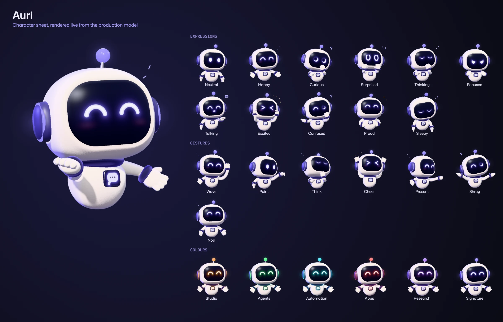

# Auri: the ADAI Systems character

Auri is ADAI's real-time 3D companion. This document covers:
- the character design and the reference it follows;
- how the model is built (geometry, materials, face);
- the animation system (expressions, gestures, reactions, idle life);
- colour variants;
- the tools that render character sheets from the live model;
- the contract an authored model must follow to replace the procedural one without touching the website.

Name: **Auri**, set once in `src/lib/mascot.ts`.

<p align="center"></p>

## 1. Design (revision 3, November 2026)

The design follows Alex's reference sheet, "New Mascot Screenshot" (kept outside the repository). That sheet is the source of truth for Auri's proportions, face, materials and expression language. Its poster layout, labels and text are not used anywhere.

| Part | Design |
|---|---|
| **Silhouette** | A floating companion: an oversized, soft capsule head (about half of Auri's height, 1.2 times as wide as it is tall), a compact rounded body, short soft arms, big mitten hands. No legs. |
| **Head** | A smooth satin ivory shell, rounder at the crown and fuller at the jaw. |
| **Face display** | A large, glossy black display set into the head: a very rounded rectangle about 78 % of the head's width, sunk into a real recess with a rolled lip around it. |
| **Eyes** | Luminous white strokes and shapes with a soft glow in the accent colour. They are designed shapes, not dots (see §3). The face has no mouth, except an animated one while talking. |
| **Antenna** | A short metal stalk on a soft collar, slightly off-centre and leaning, with a glossy, glowing ball. It bends on a spring and reacts to mood. |
| **Ear modules** | Deep indigo housings with a glowing light ring and a glossy dark cap, integrated into the sides of the head. |
| **Body** | Smooth ivory, fullest at the chest. A thick navy collar where the head rests, and a glossy chest tile with the ADAI speech bubble (with its three dots) lit from inside. |
| **Arms and hands** | Soft tapered arms of a fixed length (1.0 rig units along the curve) that bend at a soft elbow, navy cuffs, and chunky four-finger mittens with a thumb, able to make a fist, point, or spread. |
| **Light** | A cool violet back light and an accent-coloured rim glow on the silhouette, as in the reference. |

Differences from the reference that were deliberate:
- **The body is ivory with a navy collar**, as in the reference's expression sheet, not the navy top of its large hero illustration. The brief asks for an ivory body with a navy accent at the neck.
- **Colour variants keep the shell ivory**: only the lights change. The reference's small variant thumbnails tint the whole head, but the brief asks for the ivory body and black face to stay constant.
- **The surface is smooth satin, not fur.** The reference is rendered as soft plush, but a fibre texture read as leather at website sizes (Alex's feedback, 18 November 2026), so the shell is smooth soft-touch plastic like the face's glass is smooth.

## 2. How Auri is built (procedural, in `src/gl/mascot/`)

Auri is generated in code at start-up: no model, texture or image is downloaded (0 bytes of 3D assets).

| File | What it does |
|---|---|
| `shapes.ts` | All geometry. Soft parts are high-resolution spheres reshaped per direction (superellipsoids plus soft directional bulges). The head shell is carved by the face SDF: the display is pushed into a recess with a rolled lip. The glass is sampled from the same surface, sunk into the recess and slightly domed. The hand is one mesh with three morph targets (`fist`, `point`, `spread`); its fingers are capsules bent along their length. The arms are `ArmTube`s: a tapered tube along a cubic Bézier from shoulder to wrist, rebuilt each frame (about 270 vertices per arm). |
| `materials.ts` | The smooth satin ivory shell (soft-touch plastic with a light clearcoat), the navy collar and cuffs, the ear housing and cap, the light materials, and the chest tile with its emblem drawn by shader. There is deliberately no grain, fibre or bump texture: at website sizes any micro-texture reads as leather. The display's lip and groove are shaded per pixel from the same SDF that carved the geometry, so they stay crisp at any vertex count. An accent-tinted fresnel rim gives the reference's glowing edge. The chest tile is ink-dark and only faintly reflective, so the emblem never fogs over when Auri leans back. |
| `faceMaterial.ts` | The face shader (see §3). |
| `expressions.ts` | The eleven expressions, the emote and resting arm pose that go with each, and blending. |
| `emotes.ts` | The small symbols beside the head (`?`, `!!`, thinking dots, a speech bubble, sparkles, `z z`). They are drawn once into a canvas atlas with vector paths and shown on four pooled sprites, outside the bounds used for framing. |
| `palette.ts` | The accent colours (see §5). |
| `poses.ts` | Story poses used by page sections: expression, arrival gesture, colour, glyph styling, turn. |
| `ProceduralMascot.ts` | Assembles the rig and animates it (see §4). |
| `rig.ts` | The `MascotRig` interface the website talks to. |
| `GltfMascot.ts` | The same interface, for an authored GLB. |

Budget, measured from the live scene (`?glyphdebug`, `__adaiRender.mascot`):
- 20 meshes, 7 of them shadow casters, and up to 4 visible sprites;
- about 86k triangles at desktop detail and 59k on touch screens. Most are in the head shell, which needs them for a clean silhouette and recess;
- 34 WebGL draw calls per frame for the whole canvas (character, shadow and glyph passes), against 23 for the previous Auri;
- 23 shader programs in total, because materials share programs;
- no texture downloads, only two small canvas textures (the glow and the emote atlas).

Before/after performance is in `docs/performance/auri-redesign/README.md`.

## 3. The face

Everything on the display is a signed distance field in head-local units, so it is sharp at any size and transitions are true shape morphs.

Each eye is a weighted blend of six designed shapes:

| Shape | Looks like | Used by |
|---|---|---|
| `dot` | a soft filled oval | neutral, focused (with a lid cut) |
| `ring` | a tall O | surprised |
| `arc` | ∩, a smiling eye | happy, talking, proud, one eye of confused |
| `line` | ‿, a closed relaxed eye | thinking, sleepy (lower and heavier) |
| `moon` | a crescent glancing sideways | curious, one eye of confused |
| `chevron` | `>` and `<`, squeezed shut | excited |

On top of the shapes:
- each eye has its own openness, size, offset and an angled **lid cut** (focused gets determined, inward-sloping lids);
- **blinks** squash open eyes; closed shapes only dip;
- **gaze**: the eyes lead the head;
- a small **mouth** appears and moves in syllables only while talking;
- a faint **blush** for happy, excited and proud.

The glass has an inner rim shadow (it sits below the shell's lip), a broad soft window reflection, a key glint and a fresnel sheen.

## 4. Animation

Animation is layered, so the layers never fight over a transform. This is what lets Auri look curious while pointing, or sleepy while waving:

| Layer | Owns | Sources |
|---|---|---|
| Face | eyes, mouth, lights | the expression; blinks and gaze on top |
| Head | yaw, pitch, roll | gaze + expression tilt/pitch + gesture additive (nod, think, shrug) + idle drift, summed and clamped |
| Arms and hands | hand position, orientation, finger pose | the gesture (by envelope: rise, hold, settle), over the expression's resting arm pose, over rest; then springs. A hand can never be placed farther than the arm reaches, and each frame the arm's bend is solved so its length along the curve stays constant (no stretching). Every pose keeps hands and forearms out of the head; a test sweeps all of them |
| Body | hover, lean, sway, hop, squash | float + breathing, the expression's lean, gesture and reaction hops |
| Antenna | bend, perk | a damped spring driven by head motion and hops, plus the expression's perk |

**Expressions** are complete moods: eye design, head tilt and pitch, lean, antenna perk, light brightness and pulse, body energy, a resting arm pose (for example chin in hand when thinking, fists on hips when proud, fists up when excited), and an emote. They blend over about 0.2 s.

**Gestures** (wave, point, think, cheer, present, shrug, nod) are hand key poses on the side of the page content, with a little motion of their own, blended by envelope. A gesture may suggest a mood (a wave suggests happy), but never overrides an expression someone chose.

**Reactions:**
- **click or tap:** one of four playful responses (a surprised hop, a giggle, a wave back, a wiggle), never the same twice in a row. A hop only starts from rest and never stacks, so rapid clicks can't launch Auri;
- **hover:** resting the cursor on Auri earns a brief happy look and an antenna twitch, at most once every 9 s;
- **notice:** a cursor arriving near Auri makes it curious;
- **startle:** a very fast flick near it.

**Idle:**
- gentle hovering, breathing, sway and blinking (with occasional double blinks);
- every 14 to 26 s with nothing going on, one small behaviour: a glance, an antenna twitch, or a brief smile;
- after 28 s without input, Auri gets sleepy, and wakes with a startle.

**Reduced motion:** no idle motion, gestures, springs, emote animation or glyph animation. Auri holds its pose and renders only when something changes.

**Cursor:** the eyes lead (fast), then the head (medium), then the body (slow), with clamps. A call to action under the pointer draws Auri's gaze. Story choreography and the page event API are unchanged: see `docs/ARCHITECTURE.md`.

## 5. Colour variants

Only the lights change (antenna ball and halo, ear rings and halos, chest emblem, the glow in the eyes, the shell's rim glow, the collar sheen and the scene's rim light), so it is always recognisably the same Auri.

| Variant | Hex | Where |
|---|---|---|
| Signature | `#8f82ff` | the default look: home hero, Meet Auri, most pages |
| Studio | `#ffa63f` | Meet Auri control |
| Agents | `#4fdd7e` | the agents chapter and service page |
| Automation | `#2fdbe6` | the automation chapter and service page |
| Apps | `#ff6e68` | the apps chapter and service page |
| Research | `#b47dff` | the research chapter, service page and `/research` |

These are Auri's own accent colours (`src/gl/mascot/palette.ts`). The site's interface colours for each kind of work are separate and unchanged (`src/styles/global.css`).

## 6. The glyph renderer and the lens

Unchanged in this revision; see `docs/ARCHITECTURE.md` and `docs/performance/README.md`. The lens still covers the new model exactly (0 uncovered 3D pixels at every probed position: face, antenna, ears, body, both hands). Emote sprites and light halos are part of the rendered silhouette, so they turn into glyphs inside the lens too.

## 7. Rendering Auri for documents (`?lab`)

`/mascot?poster&lab` adds `window.adai.lab`, a deterministic stepping API: the render loop pauses and time advances only through `step(seconds)`, so a gesture can be captured at an exact moment. It has no effect without `?lab`.

```bash
npm run dev
node scripts/auri-lab.mjs http://localhost:4321 /tmp/auri --sheet          # every expression, gesture, colour, four angles, and the sheets (PNG)
node scripts/to-webp.mjs 2400 0.88 /tmp/auri/*sheet.png /tmp/auri/expressions.png /tmp/auri/gestures.png /tmp/auri/colours.png  # the versions kept in docs/assets/auri
npm run still                                                            # docs/assets/auri.{png,webp}
```

## 8. Asset pipeline (replaceable without touching the site)

```text
public/mascot/manifest.json   { "renderer": "procedural" }  or  { "renderer": "gltf", "src": "/mascot/auri.glb", "faceShader": true }
        │
        ▼
World.loadMascot() ── gltf ok? ──► GltfMascot (authored)  ──┐
        │ (any failure)                                     ├─► MascotRig interface ─► story, glyphs, events
        └────────────────────────► ProceduralMascot ────────┘
```

`npm run mascot:glb` exports the live procedural Auri as a GLB blockout (`assets-src/mascot/auri-blockout.glb`) with named nodes, ready to retopologise, UV, rig and animate in Blender.

### GLB contract

| Kind | Required names | Notes |
|---|---|---|
| Nodes | `head` (look-at pivot), `body`, `hand_L`, `hand_R`; optional `sprout` (the antenna) | Y up, +Z forward. Total height about 3.1, visual centre at y ≈ 1.5, head centre at y ≈ 1.78 (or set `headCenterY` in the manifest). |
| Mesh | `visor` | Its material is replaced by the procedural face shader (`faceShader: true`). The shader reads **object-space x/y in head units**: display centre at (0, -0.03), half-size 0.8 × 0.6. |
| Morph targets | `blink_L`, `blink_R`, `smile`, `surprise`, `squint`, `think` | Optional; used only if the face shader is turned off. |
| Clips | `idle_loop`, `wave`, `point`, `think`, `cheer`, `present`, `shrug`, `nod` | `idle_loop` plays continuously; the others play once on demand. |
| Materials | `glow`, `core` | These take the accent colour as emissive. |

Budgets for an authored model (research spec §4.1): ≤ 25k triangles desktop / 10k mobile, ≤ 60 bones, ≤ 8 morph targets, KTX2 textures, GLB ≤ 2.5 MB / 1.0 MB with meshopt.

## 9. Decisions for Alex
- Whether to show the navy "hoodie" body from the reference's large illustration instead of the ivory body. It's a material and geometry change in `materials.ts` and `shapes.ts`, and nothing else would need to change.
- Whether Auri should appear on case-study pages (currently it doesn't, to keep them fast and focused).
