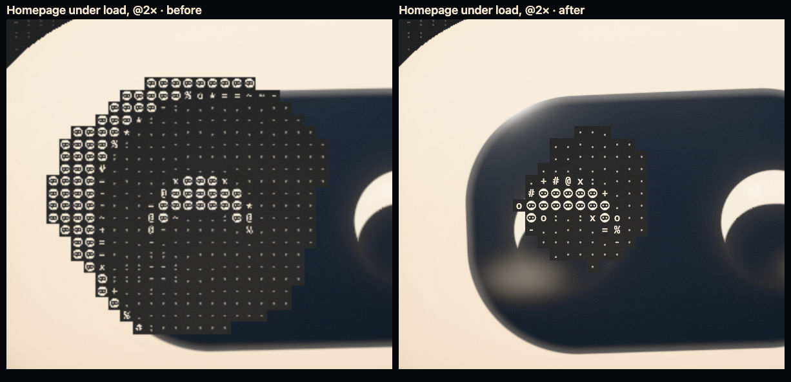
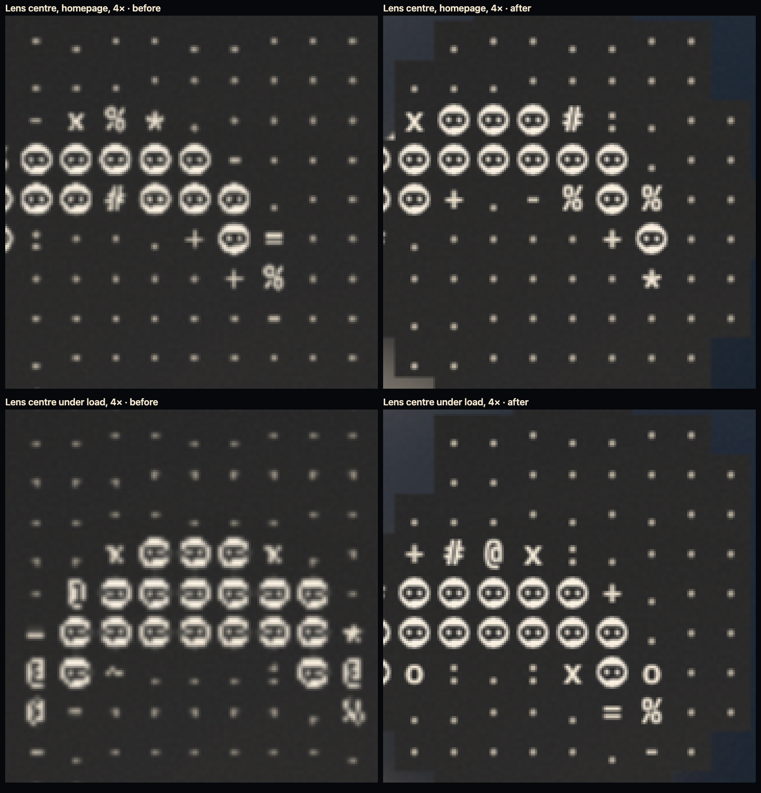
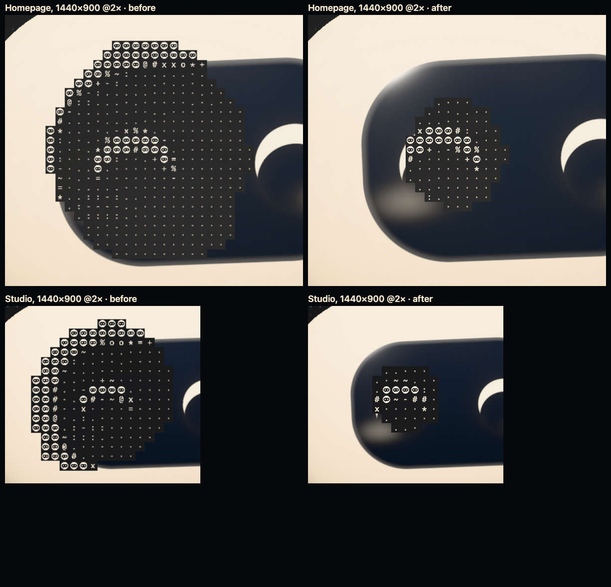
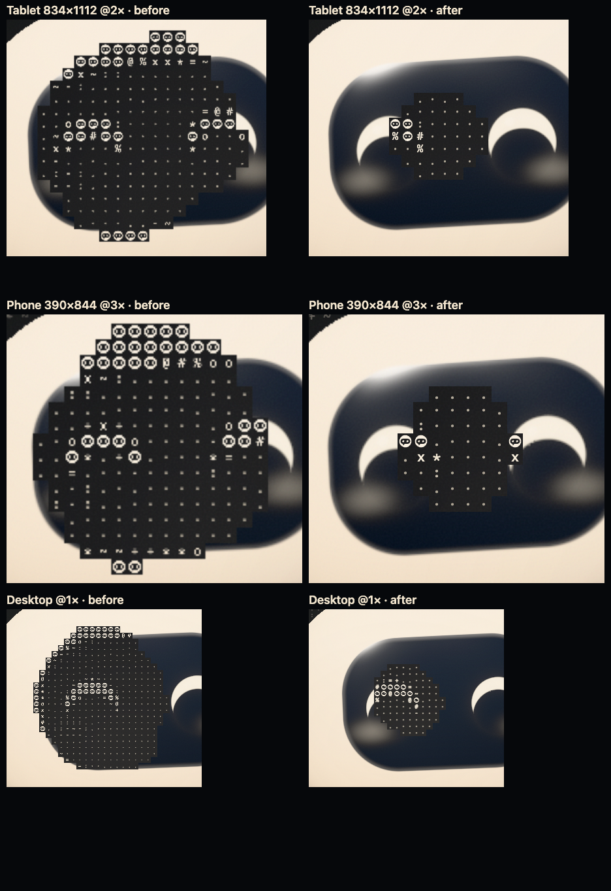
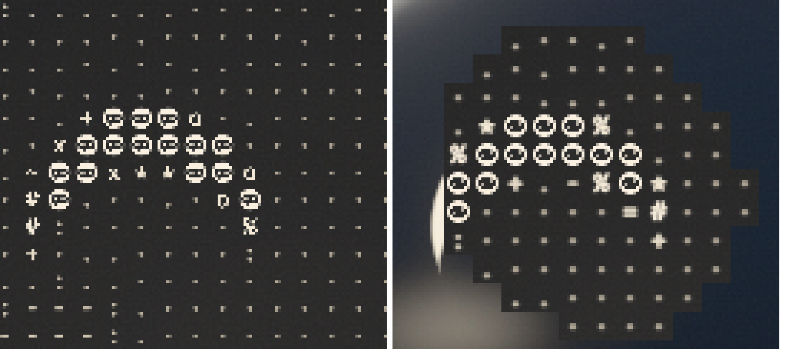

# Rendering performance and glyph quality (November 2026)

This folder holds the before/after benchmarks and screenshots for the homepage rendering work. "Before" is commit `86e3397`, the production build at the start of this work. "After" is the commit that added this folder.

## Method

- **Browser.** Google Chrome via Playwright, with the GPU enabled (Apple M1 Pro, ANGLE Metal), headless, 1440×900 at 2× unless stated otherwise.
- **Local runs.** Both builds were served by `scripts/serve-static.mjs`, which behaves like Vercel for this site: clean URLs, brotli, immutable `/_astro` assets. "Before production" was measured on https://adai.systems itself.
- **Cold and warm.** Cold is a first visit in a fresh browser context. Warm is a second visit in the same context, with the HTTP cache primed.
- **Throttled.** Chrome DevTools emulation: 9 Mbps down, 1.5 Mbps up, 150 ms RTT, and the CPU slowed 4×.
- **Trials.** 5 per start-up figure (3 for the phone viewport). Tables give medians; ranges are in the JSON files.
- **Tools.** `scripts/render-bench.mjs` collects the numbers and `scripts/glyph-quality.mjs` takes the screenshots. Each JSON file records the exact options used.

### What is measured, and what isn't

| Figure | How | Status |
|---|---|---|
| FCP, LCP, long tasks | `PerformanceObserver` (`paint`, `largest-contentful-paint`, `longtask`) | measured |
| Auri's first frame | `performance.mark('adai:gl-first-frame')` in `World.init` | measured |
| GPU time per frame | `EXT_disjoint_timer_query_webgl2`, `TIME_ELAPSED` around each frame's WebGL work; disjoint periods discarded | measured, on this GPU only |
| Frame intervals | `requestAnimationFrame` timestamps | measured, but headless Chrome holds 60 Hz here in every case, so they don't separate the builds (see below) |
| Serialised frame cost, "GL ms per second" | `gl.finish()` after each WebGL callback | comparative only. It includes the GPU-process round trip and varies between runs (about 1–2 ms per frame on this machine for either build). |
| Glyph sharpness | Images, plus two proxies (gradient energy, mid-tone share) in `screenshots/glyph-quality.json` | The proxies depend on which glyphs fall in the 20 px sample square, so they swing between captures. Quality judgements here rest on the images. |

There are no FPS claims for other hardware. A slower GPU will show larger absolute numbers.

## 1. Why homepage glyphs looked worse

**Root cause: a performance-related resolution reduction, made worse by how the glyphs were sampled.** Glyph configuration and rendering resolution were identical on every page. With no load, the homepage and `/studio` had the same 2160×1350 canvas (1.5×), the same 9.5 CSS px cells and the same atlas. There is only one 3D model on the homepage: the mascot areas are empty layout boxes for the same Auri, and there is one renderer, one canvas and one WebGL context.

The difference came from the frame-time watchdog in `World.ts`:
- **What it measured.** It averaged `requestAnimationFrame` intervals over 90 frames. These measure the whole browser's frame cadence: page work, other tabs, image decoding during scroll. They don't measure Auri's GPU cost.
- **How it reacted.** Above an average of 26 ms it lowered the **whole canvas**, glyphs included, by 0.25 steps down to 0.85×.
- **Why it rarely recovered.** It stepped back up only below an average of 17.5 ms. On a 60 Hz screen, five dropped frames in 90 already block that, so a few hitches kept it down for good.

In the very first measurement of this work (`/` first, on a machine that was still busy), the homepage dropped 1.5 → 1.25 → 1.0 → 0.85 within 12 s and stayed at 30 fps. Frames stayed slow even at 0.85×, so resolution wasn't what made them slow. `/mascot` dipped to 1.25 and recovered; `/studio` and `/work` held 1.5.

The effect was reproduced in a controlled way by injecting main-thread load:

| Load | Before (canvas, glyphs included) | After (glyphs / 3D) |
|---|---|---|
| None | 1.5× | 2× / 1.5× |
| 7 s of 30 ms work per frame | 1.25× → 1.0× (0.85× in the screenshot run) | 2× / 1.25× |
| Then one slow frame in 12 (normal jank), 12 s | stays at 1.0× | 2× / back to 1.5× |
| Then calm | 1.5× | 2× / 1.5× |

The homepage is where visitors land cold, so its first seconds overlap with loading, and it is the longest page to scroll. That makes it the page where this happened. Three things made a lowered resolution look bad:
- **A shrunken 64 px atlas.** The glyph atlas was a 64 px bitmap squeezed into 14 px (1.5×) or 8 px (0.85×) cells with bilinear filtering and no mipmaps. That aliases: dots become dashes and the mark breaks up.
- **Uneven cells.** 9.5 × 1.5 = 14.25 px, so cells alternated between 14 and 15 pixels and the same glyph rendered differently from cell to cell.
- **Stretching.** The canvas was then stretched to the screen (1.33× on a 2× screen, 2.35× at 0.85×), which blurred everything again.

## 2. What changed

**Glyph quality** (`src/gl/passes/`):
- **Native density.** The canvas and glyph pass run at the screen's own pixel density: 2× on a 2× screen, up to 3× on phones (2× when a 3× canvas would exceed 6 MP).
- **Whole-pixel cells.** Cells are a whole number of device pixels: 19 px at 2×, 10 px at 1×, 24 px for 8 CSS px cells on a 3× phone.
- **Pixel-exact atlas.** The glyph atlas is drawn by the browser's text renderer at exactly the cell size and read texel for texel (`texelFetch`). Below 14 px, a hairline stroke and a steeper edge on the mark keep 1× glyphs legible.
- **Separate 3D resolution.** The 3D scene keeps its own target, at 1.5× desktop and 1.25× touch as before. The reduction pass works in normalised coordinates, so the glyph grid stays locked to the 3D at any pair of resolutions. Coverage is unchanged: 0 uncovered 3D pixels inside the lens core at every probe position, at 1×, 2× and 3× (`glyph-probe.mjs --metric --dsf=N`, plus the test suite).

**Watchdog** (`World.ts`):
- **3D only.** It changes only the 3D resolution (steps of 0.25, floor 1×) and never the glyphs.
- **Medians against refresh.** It judges two-second windows by their median against the display's measured refresh interval, so isolated hitches don't count.
- **Undoes useless steps.** A step down that doesn't speed frames up is undone, then the resolution is left alone for 20 s.
- **Recovers.** It steps back up as soon as frames are smooth.
- **Last resort.** On 3× phones only, glyphs may drop to 2×, still sharper than the 1.25× they used to get.

**GPU work, keeping the sharper glyphs affordable:**
- **Noise per cell.** The animated noise and per-cell hash are computed once per cell in a small extra pass (about 14,000 texels) instead of for every pixel. That's roughly 360× less of that work at 2×.
- **Exact skips in the composite.** It skips pixels beyond 2.4 mascot radii, where the halo is below 1/255. It skips the glyph maths where neither the 3D pixel nor its cell touches Auri, and the aura maths where the ring can't produce an aura glyph. Each skip is exact: the output would have been zero.
- **No clear or blending.** The composite writes every pixel, so it no longer needs a canvas clear or blending.
- **Offscreen pause.** No GPU work is done while no mascot area is in view and Auri has faded out.

**Start-up:**
- **Early chunk download.** A build-time hint (`preloadWebGL` in `astro.config.mjs`) starts a low-priority `modulepreload` of the WebGL chunk at the end of `<body>`. It is skipped with Save-Data or `?nowebgl`. Under throttling the chunk now starts downloading at about 345 ms instead of about 790 ms.
- **Parallel small fetches.** `gl-loader.ts` fetches the mascot manifest and the glyph font in parallel with the chunk. Before, the manifest was fetched serially before Auri was built: one idle round trip.
- **Shaders compiled ahead.** The glyph passes' shaders are compiled with `compileAsync` before the first frame. Before, they compiled synchronously inside it.

**Lens:** `LENS_SCALE, LENS_MIN, LENS_MAX` went from `0.24, 0.06, 0.165` to `0.12, 0.03, 0.0825`. The diameter is exactly half at every viewport, as measured below. A later adjustment set the lens midway between the two: `0.18, 0.045, 0.12375` (see `docs/MASCOT.md`). The measurements in this folder were taken with the half-size lens, which doesn't affect them.

## 3. Results

### Start-up, throttled (fast 4G, 4× CPU), local, medians of 5

| | FCP / LCP | Auri's first frame | Total blocking time | Longest task |
|---|---|---|---|---|
| Homepage, cold, before | 548 ms | **1646 ms** (1641–1658) | 190 ms | 115 ms |
| Homepage, cold, after | 560 ms | **1475 ms** (1464–1477) | 187 ms | 115 ms |
| `/studio`, cold, before | 508 ms | **1400 ms** | 185 ms | 114 ms |
| `/studio`, cold, after | 516 ms | **1166 ms** | 183 ms | 114 ms |
| Homepage, warm, before | 260 ms | 678 ms (676–682) | 112 ms | 102 ms |
| Homepage, warm, after | 268 ms | 699 ms (694–704) | 118 ms | 102 ms |

- **Cold visits.** Auri appears **171 ms sooner on the homepage (−10 %)** and **234 ms sooner on `/studio` (−17 %)**. FCP and LCP (the headline text) are unchanged within run-to-run noise (±10 ms).
- **Warm visits.** Warm visits are about 20 ms slower: consistent, small, and not recovered. The likely cause is that three more shader programs are awaited through `compileAsync` before the first frame. Also under throttling, one small shared page module (`mascot-bus.js`) arrives about 100 ms later because it shares bandwidth with the early chunk download. The headline is visible without JavaScript, so this doesn't delay the first view.
- **Production baseline.** For reference, production before this work (`before-production-throttled.json`) showed the homepage's first frame at 1507 ms cold and 645 ms warm. Unthrottled production: 429 ms cold, 240 ms warm.

### Start-up on production (https://adai.systems), medians of 5

The "before" runs were made against commit `86e3397`, about an hour before deployment. The "after" runs were made against `c257923` (deployment `dpl_8mKKXPUjvVdzan9UCjEA1wmQQ9Us`), twice. Real network timing varies by ±50–80 ms between runs, so both after runs are shown.

| | Before | After, run 1 | After, run 2 |
|---|---|---|---|
| Homepage, throttled cold: FCP / first frame / blocking time | 596 / **1507** / 186 ms | 632 / **1354** / 232 ms | 596 / **1277** / 196 ms |
| Homepage, throttled warm: first frame | 645 ms | 722 ms | 642 ms |
| `/studio`, throttled cold: first frame | **1450** ms | **1200** ms | **1242** ms |
| `/studio`, throttled warm: first frame | 605 ms | 653 ms | 662 ms |
| Homepage, unthrottled cold / warm: first frame | 429 / 240 ms | 375 / 263 ms | |
| `/studio`, unthrottled cold / warm: first frame | 419 / 242 ms | 356 / 232 ms | |

- **Cold visits.** Auri's first frame is consistently 150–250 ms earlier.
- **Warm visits.** Results are mixed, between equal and about 50–75 ms later, in line with the small warm regression measured locally.
- **FCP and blocking time.** These moved by amounts within the run-to-run spread.

Unthrottled on the local server, start-up is CPU-bound and unchanged: first frame 263 → 264 ms cold and 205 → 217 ms warm on the homepage. Blocking time is 16 → 13 ms.

### Rendering

| | Before | After |
|---|---|---|
| Canvas (glyph) resolution, 1440×900 @2× | 2160×1350 (1.5×), stretched to the screen | 2880×1800 (2×), 1:1 with the screen |
| 3D resolution | same as the canvas | 1.5× (unchanged); 1.25× under load, then recovers |
| Glyph cell | 14.25 px (uneven 14/15) | 19 px |
| Atlas | 64 px bitmap, resampled | 19 px, texel-exact |
| Phone 390×844 @3×: glyphs | 1.25× in a real phone browser (fine-pointer emulation: 1.5×) | 3× |
| Under sustained load | whole canvas down to 0.85×, sticky | glyphs stay 2×; 3D steps down and back |
| **GPU time per frame, homepage, idle / lens** (timer query) | 3.54–3.85 / 3.67–3.82 ms | 3.16–3.40 / 3.28–3.79 ms |
| GPU time per frame, `/studio`, idle / lens | 3.46–3.55 / 3.29–3.65 ms | 2.77–3.24 / 2.88–3.01 ms |
| GPU time per frame, phone 390×844 @3×, homepage idle / lens | 1.76 / 1.73 ms (glyphs at 1.5×) | 1.99 / 1.88 ms (glyphs at 3×) |
| Draw calls per frame | 22 | 23 (the per-cell noise pass) |
| rAF loops running | 2 (World, Lenis) | 2 |
| WebGL contexts | 1 | 1 |

GPU ranges span two separate runs of each build. On desktop, the 2× glyph pass now costs slightly less GPU time than the old 1.5× one. On a phone viewport it costs about 0.1–0.25 ms more, for 5.8× as many glyph pixels. A first version of the new composite, before the per-cell noise pass and the exact skips, measured 6.3 ms on the homepage. That is what the extra work fixed.

**Reading the page** (scroll 700 px, pause 1.5 s, down to the footer). This shows the share of frames that drew anything, and the serialised GL cost per second:

| | Before | After |
|---|---|---|
| Homepage, desktop | 100 % of frames, 68.6 ms/s | 90 %, 60.9 ms/s |
| `/studio`, desktop | 100 %, 61.4 ms/s | 25 %, 17.3 ms/s |
| Homepage, phone 390×844 @3× | 100 %, 94.6 ms/s | 59 %, 31.0 ms/s |
| `/studio`, phone | 100 %, 88.9 ms/s | 5 %, 2.1 ms/s |

Auri is out of view at 26 % of homepage scroll positions on desktop and 56 % on a phone. Before, every one of those frames still rendered the full 3D, shadow and glyph passes. After a fast jump to any section, the very next frames draw Auri there (tested).

**Frame intervals** were 16.7 ms median, p95 16.8 ms, with no frame over 20 ms, for both builds in every scenario (idle, lens, scroll). Headless Chrome on this machine holds 60 Hz in all of them, so this measurement can't show a difference. The watchdog experiment above is the real test of behaviour under load.

### Glyph quality

Visual observations, not measurements:
- **2× and 3× screens.** Glyphs are crisp at native resolution, and the mark's ring, bubble and eyes are distinct.
- **Under load.** Before, the homepage turned the mark into blobs and the dots into dashes. After, nothing changes.
- **Homepage vs `/studio`.** They now render glyphs identically (asserted by a test: same canvas density, cell size and atlas).
- **1× screens.** Dots are uniform squares instead of uneven dashes, and `#`, `@` and `%` are clean. The 10 px mark is faithful but finer than the old, accidentally chunky version.

### Lens size (radius in viewport heights, from the `?glyphdebug` hook)

| | Before | After |
|---|---|---|
| Homepage 1440×900 | 0.1650 | 0.0825 |
| `/studio` 1440×900 | 0.1190 | 0.0595 |
| Homepage tablet 834×1112 | 0.0978 | 0.0489 |
| Homepage phone 390×844 | 0.0978 | 0.0489 |
| `/studio` tablet | 0.0600 | 0.0300 |

## Files

| File | Contents |
|---|---|
| `before-local*.json`, `after-local*.json` | Same server, same browser. Suffixes: `-throttled` (fast 4G + 4× CPU), `-mobile` (390×844 @3×), `-reading` (reading pass), `-gpu` (timer queries) |
| `before-production*.json` | https://adai.systems at commit `86e3397` |
| `after-production*.json` | https://adai.systems after deployment of `c257923` (`-throttled-run2` is the repeat run) |
| `screenshots/` | Comparison sheets and `glyph-quality.json` (resolutions, lens radius and sharpness proxies per case) |
